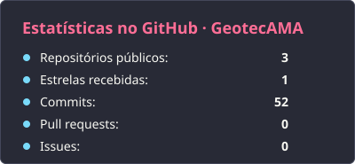
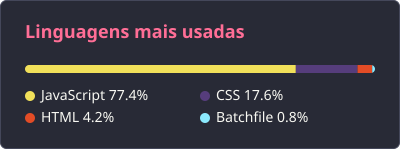

### Olá! Somos o SENAI CIMATEC da área de Meio Ambiente e Segurança com foco em Projetos de Desenvolvimento & Inovação 🌍 🧭 💡

<!-- cartões gerados por .github/workflows/cartoes.yml (sem serviço externo) -->

## Tecnologias que estamos usando no dia-a-dia

 
    
    
    
    
    
    
    

 

## 🌱 Estamos comprometidos com a inovação e sustentabilidade para um futuro melhor! 💡🌍🔄
